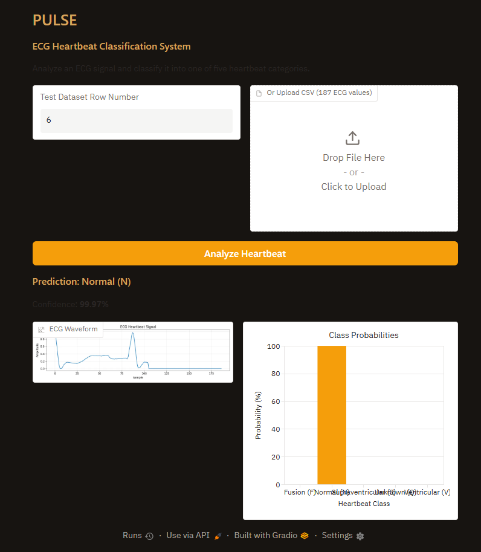

# ECG Heartbeat Classification

A machine learning project that classifies ECG heartbeat signals into five categories using a manually implemented neural network in PyTorch. The project also includes an interactive Gradio application called **PULSE**.

## Project Information

**Course:** Applied Machine Learning  
**Project:** Assignment 3 – Classifying Heartbeats from ECG Signals

### Team Members

| Name | Roll Number |
|---|---|
| Shoaib Mansoor | 23F-6037 |
| Muhammad Malik | 22F-3487 |

## 1. Project Overview

An electrocardiogram (ECG) records the electrical activity of the heart. Different heartbeat patterns can provide useful information about heart activity.

In this project, we developed a neural network that classifies ECG heartbeat signals into five categories. The model takes 187 ECG signal values as input and predicts the corresponding heartbeat class.

The neural network, loss function, gradient checking, and mini-batch SGD training updates were implemented manually using PyTorch.

## 2. Dataset

We used the ECG Heartbeat Categorization Dataset from Kaggle.

**Dataset:** [ECG Heartbeat Categorization Dataset](https://www.kaggle.com/datasets/shayanfazeli/heartbeat)

The project uses:
- `mitbih_train.csv`
- `mitbih_test.csv`

Each ECG heartbeat contains 187 signal values and one corresponding class label.

The five heartbeat categories are:

| Label | Category |
|---|---|
| 0 | Normal (N) |
| 1 | Supraventricular (S) |
| 2 | Ventricular (V) |
| 3 | Fusion (F) |
| 4 | Unknown (Q) |

## 3. Neural Network Architecture

The neural network uses the following architecture:

**187 → 128 → 64 → 5**

- Input layer: 187 features
- Hidden layer 1: 128 neurons with ReLU activation
- Hidden layer 2: 64 neurons with ReLU activation
- Output layer: 5 logits

The model contains **32,645 trainable parameters**.

Weights and biases were manually created using `nn.Parameter`, with He initialization for weights.

## 4. Training

The model was trained using manually implemented mini-batch Stochastic Gradient Descent (SGD).

Training configuration:
- Batch size: 128
- Epochs: 30
- Momentum: 0.9
- Weight decay: 0.0001
- Learning rates tested: 0.01, 0.1, 0.5
- Selected learning rate: 0.5

The best model was selected based on validation loss.

## 5. Model Performance

The final model achieved the following test results:

| Metric | Result |
|---|---:|
| Test Accuracy | 97.81% |
| Balanced Accuracy | 82.53% |
| Normal (N) Accuracy | 99.56% |
| Supraventricular (S) Accuracy | 69.24% |
| Ventricular (V) Accuracy | 91.78% |
| Fusion (F) Accuracy | 54.32% |
| Unknown (Q) Accuracy | 97.76% |

Although the overall accuracy is high, the model performs less effectively on the Fusion (F) class due to class imbalance and difficulty distinguishing minority-class patterns.

## 6. PULSE – ECG Classification Frontend

**PULSE** is an interactive Gradio application connected to our trained neural network.

Users can:
- Select a heartbeat from the test dataset.
- Upload a CSV file containing 187 ECG signal values.
- View the ECG waveform.
- Get the predicted heartbeat category.
- View the confidence score and probabilities for all five classes.

### Live Application

**[Open PULSE – ECG Heartbeat Classification System](https://b5dd2e00b119898112.gradio.live/)**

### Frontend Screenshot



## 7. Project Structure

```text
ECG-Heartbeat-Classification/
│
├── data/
│   └── (Dataset CSV files are not included)
│
├── notebooks/
│   └── ECG_Assignment_3.ipynb
│
├── models/
│   └── ecgnet_best.pt
│
├── results/
│   ├── figures/
│   │   ├── example_beats.png
│   │   ├── confusion_matrix_heatmap.png
│   │   ├── training_validation_loss.png
│   │   └── PULSE_frontend.png
│   │
│   ├── tables/
│   └── analysis.md
│
├── app/
│   └── app.py
│
├── README.md
└── .gitignore
```

## 8. Installation and Execution

Install the required libraries:

```bash
pip install torch numpy pandas matplotlib gradio
```

Make sure the trained model is available in the `models/` directory and the required test dataset is placed in the `data/` directory.

Run the frontend:

```bash
python app/app.py
```

The Gradio application will provide a local URL that can be opened in a web browser.

## 9. Future Improvements

- Improve classification performance for minority heartbeat classes.
- Experiment with additional techniques for handling class imbalance.
- Explore deeper neural network architectures.
- Test the model on additional ECG datasets.

## 10. Acknowledgements

We acknowledge the authors of the ECG Heartbeat Categorization Dataset for making the dataset publicly available on Kaggle.

**Course:** Applied Machine Learning  
**Assignment:** 3 – Classifying Heartbeats from ECG Signals
